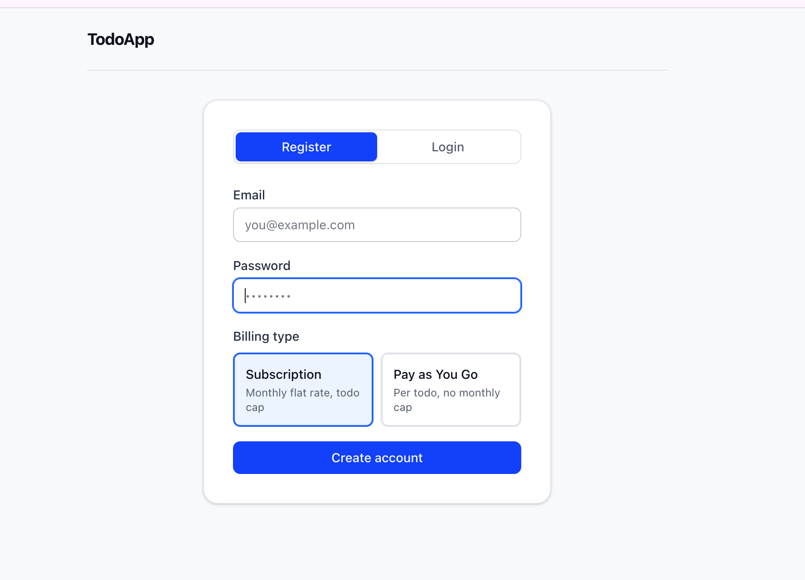
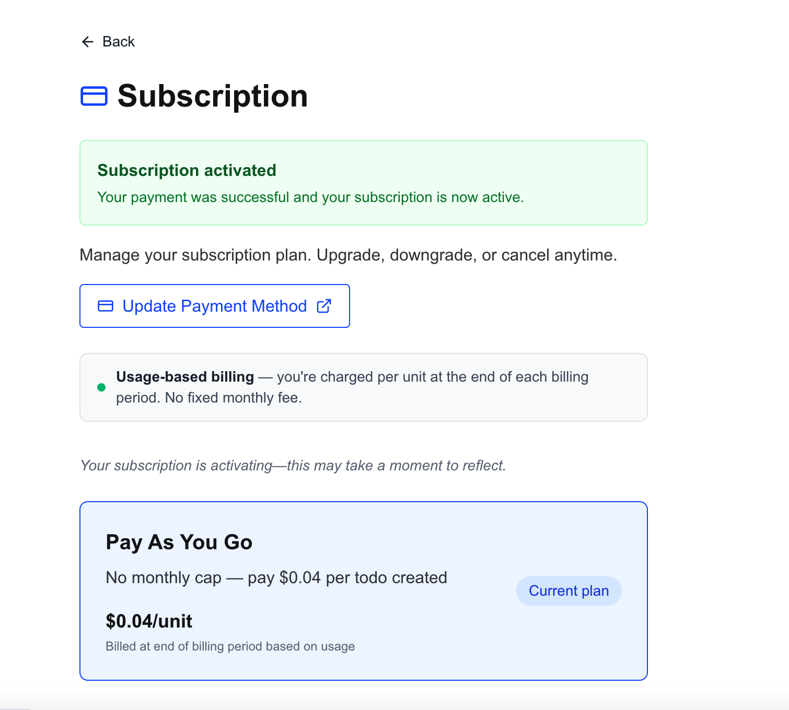
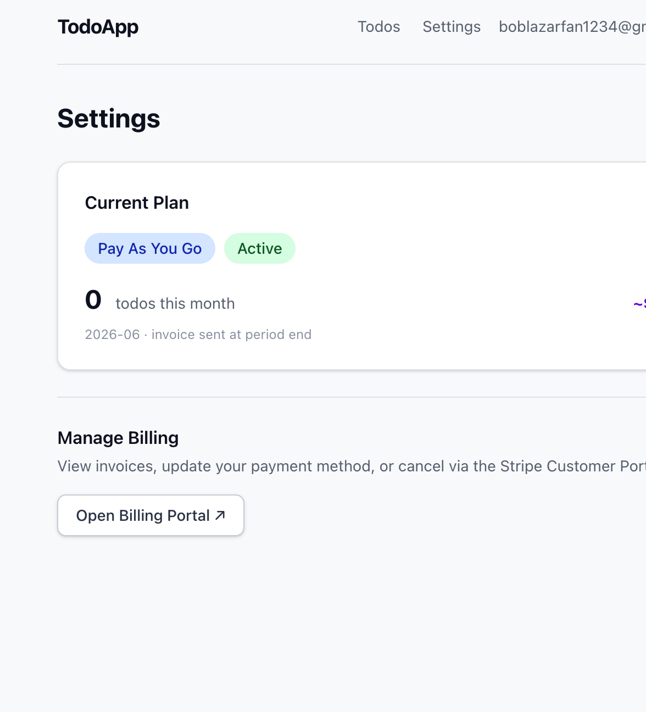

# Lyrian Stripe

> ⚠️ **Not production ready** — actively in development.

Delegate your entire Stripe billing layer to one service. Register your plans, drop in your Stripe keys — encrypted at rest with AES-256-GCM — and Lyrian handles checkout, webhooks, subscription lifecycle, cron jobs, and the billing portal UI across as many SaaS apps as you need.

> **Roadmap:** a management UI for registering apps, managing plans, and monitoring subscriptions without touching the CLI or CI workflows.

## Example app

The `example-app/` directory contains a full TodoApp demo that integrates with Lyrian. It lets new users pick a billing type at registration (flat-rate subscription or pay-as-you-go), then exercises the full flow — checkout, portal, plan switching, and cancellation.

| Register                                            | Subscription                                                              | Settings                                                      |
| --------------------------------------------------- | ------------------------------------------------------------------------- | ------------------------------------------------------------- |
| [](docs/todo-app.png) | [](docs/subscription-page.png) | [](docs/settings-page.png) |

**[Try the live demo →](https://lyrian-example-app-494926016713.us-central1.run.app/login)**

## What it does

- **Multi-app** — one deployment serves multiple SaaS products; each app has isolated Stripe credentials, plans, and email config
- **Billing models** — flat-rate, free-tier (hard cap), pay-as-you-go (metered), and volume pricing; mix and match per app
- **Checkout** — creates Stripe Checkout sessions, handles success/decline redirects, detects duplicate cards
- **Webhooks** — per-app endpoint (`/api/billing/webhook/:appId`); verifies signatures, updates subscription records
- **Portal UI** — hosted billing portal for end users (upgrade, cancel, invoice history)
- **Subscription status API** — your SaaS backend polls one endpoint to gate features
- **Cron jobs** — scheduled downgrade of expired subscriptions; runs on Cloud Scheduler
- **Encrypted credentials** — Stripe keys are AES-256-GCM encrypted at rest; decrypted only at the point of use
- **Transactional email** — per-app Resend key for subscription confirmation emails

## Registering an app

Everything is driven by a plans JSON file and the `register-app.yml` workflow (or `scripts/create-app.ts` locally).

**1. Create your plans file**

```json
[
  {
    "planKey": "basic",
    "name": "Basic",
    "description": "For individuals",
    "price": 1000,
    "billingType": "flat_rate",
    "stripeProductId": "prod_xxx",
    "stripePriceId": "price_xxx"
  },
  {
    "planKey": "paygo",
    "name": "Pay as you go",
    "description": "$0.04 per unit",
    "price": 0,
    "billingType": "metered",
    "unitAmount": 4,
    "stripeMeterEventName": "your_event_name",
    "stripeProductId": "prod_xxx",
    "stripePriceId": "price_xxx"
  }
]
```

See `scripts/example-plans.json` for a full template with all supported fields.

**2. Trigger `register-app.yml`** — provide `plans_file`, `stripe_secret_key`, `stripe_publishable_key`, `stripe_webhook_secret`, and optionally `resend_api_key` / `from_email`. Credentials are masked in logs, AES-256-GCM encrypted before writing to the DB, and the plans file is automatically deleted from the repo after registration.

**3. Register the webhook** in your Stripe dashboard:

```
POST https://your-billing-app.com/api/billing/webhook/<app-id>
```

**4. Point your SaaS at the portal** — generate a short-lived JWT and redirect users to `/api/billing/portal?token=<jwt>`.

```typescript
import jwt from "jsonwebtoken";

export function getBillingPortalUrl(userId: string) {
  const token = jwt.sign({ iss: "your-app-id", sub: userId }, process.env.SAAS_JWT_SECRET!, { expiresIn: "5m" });
  return `${process.env.BILLING_APP_URL}/api/billing/portal?token=${token}`;
}
```

**5. Gate features** by calling the status endpoint from your backend:

```bash
GET /api/subscription/status?appId=<app-id>&externalUserId=<user-id>
x-api-key: <your-api-key>
```

## Billing models

| `billingType`                     | How it works                                                                        |
| --------------------------------- | ----------------------------------------------------------------------------------- |
| `flat_rate`                       | Fixed monthly charge                                                                |
| `flat_rate` + `freeUnitsPerMonth` | Free tier with a hard usage cap; returns `allowed: false` at the limit              |
| `metered`                         | No monthly fee — each unit fires a Stripe Billing Meter event, billed at period end |
| `volume`                          | Like metered with a committed minimum and lower per-unit rate                       |

Plans can be updated at any time by re-running `register-app.yml` with a new plans file. Plans not present in the new file are deactivated automatically.

## API reference

| Endpoint                      | Method | Auth             | Description                       |
| ----------------------------- | ------ | ---------------- | --------------------------------- |
| `/api/subscription/status`    | GET    | API Key          | Subscription status for a user    |
| `/api/billing/checkout`       | POST   | API Key          | Create a Stripe Checkout session  |
| `/api/billing/portal`         | GET    | JWT (query)      | Entry point for the hosted portal |
| `/api/billing/webhook/:appId` | POST   | Stripe signature | Webhook receiver                  |
| `/api/apps/:appId/plans`      | GET    | —                | Public plan listing for an app    |

### Check subscription status

Call this from your SaaS backend to gate features based on a user's active plan.

```typescript
// lib/billing.ts (in your SaaS app)

const DEFAULT_SUBSCRIPTION = { plan: "free_trial", status: "active" };

export async function getSubscriptionStatus(externalUserId: string) {
  if (!process.env.BILLING_APP_URL || !process.env.BILLING_APP_ID || !process.env.BILLING_API_KEY) {
    return DEFAULT_SUBSCRIPTION; // graceful fallback when billing isn't configured
  }

  const url = new URL(`${process.env.BILLING_APP_URL}/api/subscription/status`);
  url.searchParams.set("appId", process.env.BILLING_APP_ID);
  url.searchParams.set("externalUserId", externalUserId);

  const res = await fetch(url.toString(), {
    headers: { "x-api-key": process.env.BILLING_API_KEY },
  });

  if (!res.ok) return DEFAULT_SUBSCRIPTION;

  return res.json(); // { plan, status, currentPeriodEnd, cancelAtPeriodEnd, ... }
}
```

**Response shape:**

```json
{
  "plan": "basic",
  "status": "active",
  "currentPeriodEnd": "2026-07-09T00:00:00.000Z",
  "cancelAtPeriodEnd": false
}
```

`status` mirrors Stripe's subscription statuses: `active`, `past_due`, `trialing`, `canceled`, `unpaid`. A missing or expired subscription returns `{ plan: "free_trial", status: "active" }` by convention.

### Initiate checkout

Redirect a user to Stripe Checkout from your backend.

```typescript
const res = await fetch(`${process.env.BILLING_APP_URL}/api/billing/checkout`, {
  method: "POST",
  headers: {
    "Content-Type": "application/json",
    "x-api-key": process.env.BILLING_API_KEY,
  },
  body: JSON.stringify({
    appId: process.env.BILLING_APP_ID,
    externalUserId: user.id,
    priceId: "price_xxx",      // Stripe Price ID for the selected plan
    email: user.email,
    returnUrl: "https://yourapp.com/settings", // where to land after checkout
  }),
});

const { url } = await res.json();
redirect(url); // Stripe-hosted checkout page
```

### Open the billing portal

Generate a short-lived JWT and redirect the user. The billing service verifies it, creates a session, and shows the portal UI (upgrade, cancel, invoices).

```typescript
import jwt from "jsonwebtoken";

export function getBillingPortalUrl(userId: string) {
  const token = jwt.sign(
    { iss: process.env.BILLING_APP_ID, sub: userId },
    process.env.SAAS_JWT_SECRET!,
    { expiresIn: "5m" }
  );
  return `${process.env.BILLING_APP_URL}/api/billing/portal?token=${token}`;
}
```

### Report usage (metered plans)

For pay-as-you-go plans, report a unit of usage after each billable action.

```typescript
await fetch(`${process.env.BILLING_APP_URL}/api/usage/report`, {
  method: "POST",
  headers: {
    "Content-Type": "application/json",
    "x-api-key": process.env.BILLING_API_KEY,
  },
  body: JSON.stringify({
    appId: process.env.BILLING_APP_ID,
    externalUserId: user.id,
    quantity: 1,
  }),
});
// Response: { allowed: true, usage: 42 }
// If the user hits a free-tier cap: { allowed: false, usage: 500, limit: 500 }
```

## Environment variables

| Variable                | Required | Description                                           |
| ----------------------- | -------- | ----------------------------------------------------- |
| `DATABASE_URL`          | ✅       | PostgreSQL connection string                          |
| `SAAS_JWT_SECRET`       | ✅       | Shared secret for JWT signing                         |
| `CRON_SECRET`           | ✅       | Secret for cron job requests                          |
| `FIELD_ENCRYPTION_KEY`  | ✅       | 64-hex-char key for AES-256-GCM credential encryption |
| `STRIPE_SECRET_KEY`     | Optional | Global fallback if app has no per-app key             |
| `STRIPE_WEBHOOK_SECRET` | Optional | Global fallback webhook secret                        |
| `RESEND_API_KEY`        | Optional | Global fallback email key                             |

## Development

```bash
yarn install
npx prisma migrate dev
yarn dev
```
